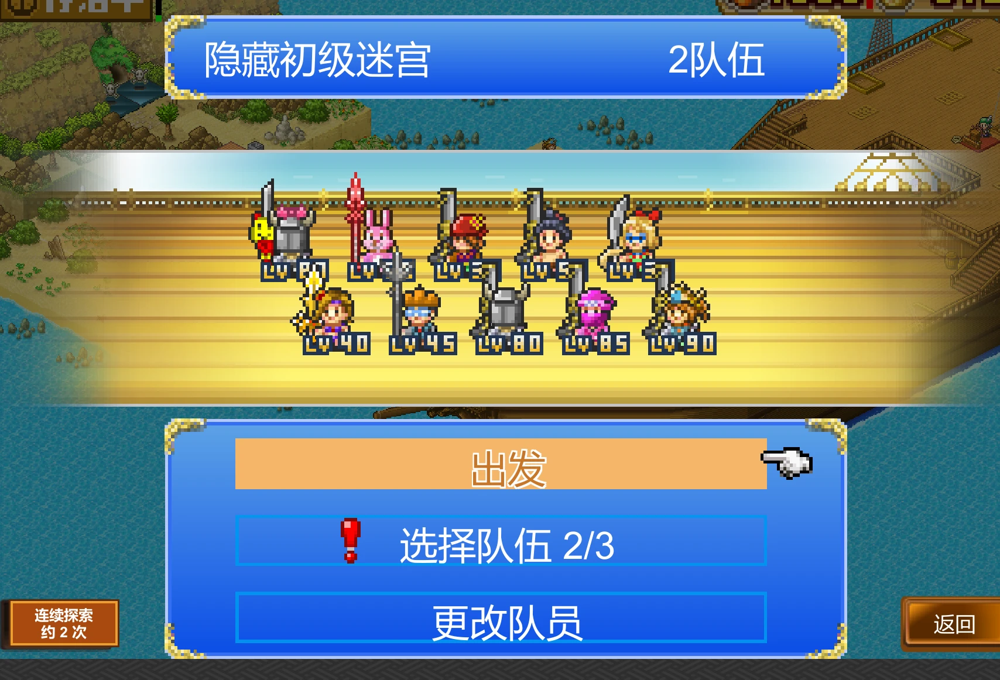
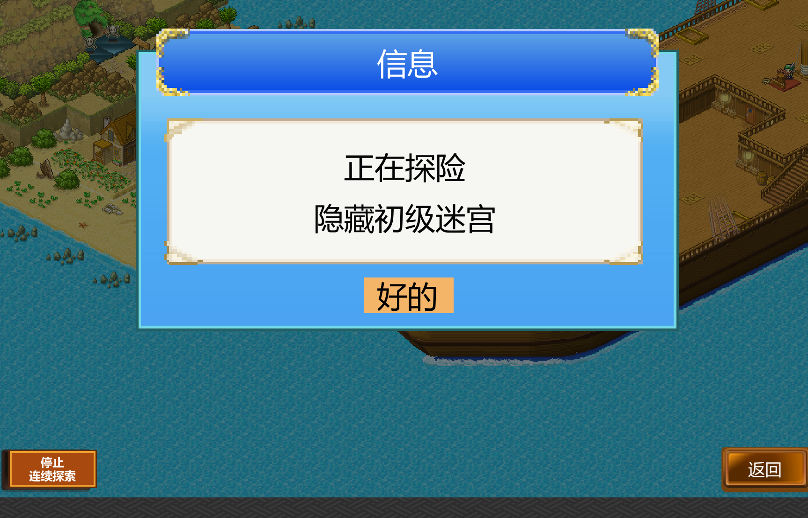

<a id="chinese"></a>

# HSSQoL — 大海贼探险物语DX 便利性 Mod

**中文** | [English](#english)

HSSQoL 是 Kairosoft《大海贼探险物语DX》（High Sea Saga DX，Steam / Windows 版）的便利性（QoL）Mod，基于 BepInEx 6 运行，不修改任何游戏文件。目前包含：

- **强化满级**：自动挑选食物，一键将角色的当前职业升到满级。
- **转职满级**：在转职页面一键转到下一个未通关的职业，并升到满级。
- **批量出售**：在港口商店一键卖出多余的装备、食物和药。
- **投入所有相性相符**：在锻造页面一键用所有契合（同种类、同重量，经验 150%）的装备把装备锻造到满级。
- **[船舱布局设计器](https://ruoanji.github.io/HSSQoL/designer/designer.html)**：按 F9 导出船舱数据和布局供网页版的规划工具加载。
- **游戏加速**：按 F2 开关，倍率可自由设置。
- **跳过迷宫结算**：按 F3 开关，迷宫通关后的横幅、宝箱展示、经验结算、俘虏选择和迷宫内对话一闪而过。
- **跳过职业通关动画**：按 F4 开关，职业升到满级时弹出的职业通关窗口一闪而过，连续转职满级时不用一个个点。
- **连续探索**：在迷宫出发页面一键反复打同一个迷宫，直到体力用完。
- **资金流水**：按 F7 查看钱从哪里来、花到哪里去，按来源（商店、战斗、各个设施的使用费等）统计。
- **鼠标滚轮**：在列表中用滚轮上下移动。

## 安装

### 第一步：安装 BepInEx 6（IL2CPP 版）

本游戏使用 Unity 的 **IL2CPP** 方式编译，不是 Mono。稳定版 BepInEx 5 只支持 Mono，所以必须使用 **BepInEx 6 的 IL2CPP 版本**。BepInEx 6 目前仍是预发布版本，要从 bleeding edge 构建页面下载。

1. 打开 <https://builds.bepinex.dev/projects/bepinex_be>，下载文件名形如 `BepInEx-Unity.IL2CPP-win-x86-6.0.0-be.<编号>+<哈希>.zip` 的压缩包。
   - 必须选 **`Unity.IL2CPP`**（不是 `Unity.Mono`）。
   - 必须选 **`win-x86`**（游戏是 32 位的，x64 版无法加载）。
   - 已测试版本：**6.0.0-be.793**。更新的 be 版本通常也能用。
2. 打开游戏根目录：在 Steam 里右键游戏 → 管理 → 浏览本地文件（即 `KairoGames.exe` 所在的文件夹）。
3. 把压缩包里的全部内容解压到这个文件夹。完成后，`KairoGames.exe` 旁边应该有 `BepInEx\`、`dotnet\`、`winhttp.dll` 和 `doorstop_config.ini`。
4. 启动一次游戏。第一次启动会**比较慢**（可能要一两分钟），因为 BepInEx 需要联网下载 Unity 基础库，并生成 `BepInEx\interop`。出现标题画面后就可以关闭游戏。
5. 打开 `BepInEx\LogOutput.log`，如果能找到 `Chainloader startup complete`，就说明 BepInEx 已经正常工作。

### 第二步：安装本 Mod

1. 获取 `HSSQoL.dll`：从 [Releases](https://github.com/RuoanJi/HSSQoL/releases) 下载，或按下方「编译」自行编译。
2. 把它放到 `BepInEx\plugins\`（没有这个文件夹就新建一个）。
3. 启动游戏，读取存档后即可使用。第一次运行会生成配置文件 `BepInEx\config\hssqol.cfg`，修改配置后需要重启游戏才会生效。

**卸载**：删除 `BepInEx\plugins\HSSQoL.dll`。要完全移除 BepInEx，再删除游戏根目录下的 `winhttp.dll`（删掉它 BepInEx 就不会再加载）。

## 强化满级


在角色菜单里，「强化」右边会多出一个圆形的 **强化满级** 按钮（原来的「团队强化」往右移了一格）。点一下，Mod 就会给这个角色喂食物，直到当前职业升到满级，然后像游戏自己的强化流程一样，发放职业通关奖励（「转职」旁的星星 +1）。

这个按钮出现在三个地方：

- 船员列表 → 点选角色
- 主菜单 → 战斗编队 → 点选编队里的角色
- 转职页面：底部「确定」和「道具」之间（右边是「转职满级」，见下文）

升到满级时，会弹出游戏自己的职业通关窗口（职业通关动画）。关闭窗口时，由游戏发放职业通关奖励，和游戏自己的流程完全一样。可用 `JobClearWindow` 关闭窗口、改为直接发放。

### 怎么挑食物

游戏自带的批量喂食会把选中的数量全部吃掉，哪怕早就满级了也一样，多出来的经验全部浪费。强化满级会一口一口地喂，每一口之前都重新计算：

1. **还差多少经验**：当前职业满级所需经验 − 现有经验。
2. **每种食物大约给多少经验**：同一种食物每次给的经验是随机的（例如「新鲜蔬菜」约 78–88），所以 Mod 会先取样算出平均值。
3. **先拿能力加成**：只考虑不会让经验溢出的食物。如果其中有食物还能提升某项能力（没到这种食物的上限），就选「每点经验带来的预期能力加成」最高的那种。每种食物只提升一项能力，每口只加 0–1 或 0–2 点，而升满一个职业的经验有限，所以经验小的食物能吃更多口、拿到更多加成，稀有的大份料理也自然不会被用掉。某项能力到达上限后，就换成提升另一项能力的食物。可用 `PrioritizeStats` 关闭这一步。
4. **再追求经验效率：优先吃库存最多的**：在「平均经验不超过剩余需求」的食物里，选**库存最多**的那种（数量相同就选经验小的）。这样不会动用稀有的高级料理，各种食物的库存也会被慢慢拉平。这不是贪心地挑经验最高的。
5. **最后一口尽量少浪费**：如果所有食物都会超出剩余需求，就吃经验**最小**的那种。所以溢出的经验最多只有一小口。

实测两个角色从 Lv 12–13 升到 Lv 35，各吃了约 100 口，溢出的经验只有几十点。

### 和游戏自己的强化完全一致

每一口都严格按照游戏自身强化的规则处理（直接读取游戏代码得出，并与游戏自己的强化窗口逐项对比验证）：

- **能力加成**：每种食物对每项能力有一个随机范围。加成有上限，上限按食物等级而定：(等级 + 1) × 10，即 10 / 20 / 30 / 40。比较的是角色这项能力的累计加成（包括职业通关奖励），达到上限后这种食物就不再提升这项能力。
- **经验值**：与游戏一样分段加入，所以达到满级时的处理也与游戏相同。
- **职业通关**：发放职业通关奖励；所有职业都通关后，按游戏规则重置已通关职业列表。

如果食物不够升到满级，Mod 会吃完所有允许使用的食物，然后停在差一点满级的位置，不会发放职业通关奖励。

每一口都会记录在 `BepInEx\LogOutput.log` 里（`[autofeed]` 开头）：吃了什么、经验和等级前后的变化、库存的变化。

可在 `BepInEx\config\hssqol.cfg` 的 `[AutoFeed]` 中设置：

| 设置 | 默认 | 说明 |
|---|---|---|
| `KeepAtLeast` | 0 | 每种食物至少保留这么多个 |
| `ExcludeIds` | 空 | 永不使用的食物 ID，用逗号分隔，例如 `22,23`。每次喂食开始时，日志会列出所有食物的 ID |
| `MaxBites` | 3000 | 每次最多喂几口（安全上限） |
| `PrioritizeStats` | true | 先选还能提升能力的食物（见第 3 步） |
| `StatFoodMaxTier` | 3 | 为了能力加成最多动用到哪个等级的食物（0–3），调低可保留稀有料理 |
| `JobClearWindow` | true | 升满时弹出游戏自己的职业通关窗口；设为 false 则直接发放奖励 |
| `ButtonConfirm` | false | 设为 true 时需要点两次：第一次预览，第二次喂食 |
| `Method` | Direct | `Direct`：瞬间完成，没有动画。`Game`：改用游戏自己的团队强化窗口，每种食物弹出一次升级动画 |

## 转职满级

转职页面底部，「强化满级」右边还有一个 **转职满级** 按钮。当前职业已满级时点一下，Mod 会：

1. 从职业列表的第一个开始往后找，选出第一个**还没通关**、并且**现在就能转**的职业（是否能转用的是游戏自己的判断：知识等级、已通关职业数量、勋章）；
2. 转到这个职业，步骤和游戏自己按「确定」转职完全一样；
3. 接着自动「强化满级」。

注意：

- 和游戏自己的转职一样，**转职会扣掉所需的知识等级**。
- 需要消耗勋章的职业默认会跳过，不会偷偷花掉勋章。想包含它们，把 `[JobSwitch]` 的 `AllowMedalJobs` 设为 true。
- 当前职业没到满级时不做任何事。如果已经满级但还没领取职业通关奖励，会先弹出职业通关窗口，关闭后再按一次即可。
- 不显示游戏的转职确认框和「转职完成」画面。

| 设置（`[JobSwitch]`） | 默认 | 说明 |
|---|---|---|
| `Enabled` | true | 是否显示转职满级按钮 |
| `AllowMedalJobs` | false | 是否也选择需要勋章的职业（会消耗勋章） |

## 批量出售

在港口商店（武器店、防具店、道具店）的「出售」页面，右下角「返回」上方会多出一个 **批量出售** 按钮。点一下就会直接卖出多余的库存（没有确认框）：

1. 持有上限低于 100 时不做任何事（道具和装备共用同一个上限）。
2. 某样东西的持有数超过上限的 50% 时，卖到只剩 30 个。
3. 只卖这几类：**所有装备**（武器、盾、头、身体、饰品）、**强化食物**、**回复 HP / SP 的药**。其他东西一律不卖：素材、改变蛋颜色的道具、知识书、星级提升道具、其他药、转职道具等。
4. 角色身上穿着的装备不算在库存里，不会被卖掉。

卖出的价格和数量变化和游戏自己的出售完全一样。

| 设置（`[AutoSell]`） | 默认 | 说明 |
|---|---|---|
| `Enabled` | true | 是否显示批量出售按钮 |
| `ThresholdPercent` | 50 | 持有数超过上限的百分之多少才卖 |
| `Keep` | 30 | 每样保留多少个 |
| `MinCap` | 100 | 持有上限低于这个值时不卖 |
| `ExcludeIds` | （空） | 永远不卖的东西，逗号分隔：游戏里显示的名字，或 `e:<id>`（装备）/ `i:<id>`（道具） |
| `ButtonX` / `ButtonY` | 260 / 199 | 按钮位置 |
## 投入所有相性相符

在锻造页面选好要强化的装备后，素材选择页面右下角「返回」上方会多出一个 **投入所有相性相符** 按钮。点一下会弹出确认框，显示要投入的装备总数、总花费和预计等级；选「是」后直接完成锻造，不用一次次放素材、点「合成」：

1. 只投入和要强化的装备**契合**（同种类、同重量，经验 150%，列表上显示 ○）的装备。头部、身体和饰品在游戏里属于同一种类，盾和拳也属于同一种类，所以重量相同就算契合。
2. 每样装备至少保留 10 个（不算正在强化的那一件）。
3. 每金币经验最高的先投入。
4. 升到满级就停下；最后一次只放刚好够满级的数量，不会浪费。钱不够下一次锻造时也会停下。
5. 内部按游戏的方式一次次锻造（每次最多放素材格子数那么多），每次的价格、扣钱、消耗素材和经验都和手动「合成」完全一样。完成后回到选择装备的列表。

| 设置（`[SmithFeed]`） | 默认 | 说明 |
|---|---|---|
| `Enabled` | true | 是否显示按钮 |
| `Keep` | 10 | 每样装备保留多少个 |
| `StopAtMaxLevel` | true | 最后一次只放刚好够满级的素材 |
| `Confirm` | true | 锻造前弹出确认框 |
| `ButtonX` / `ButtonY` | 272 / 172 | 按钮位置 |

## 船舱布局设计器

**[在线打开设计器](https://ruoanji.github.io/HSSQoL/designer/designer.html)**

设计器是一个独立的网页工具，用来规划两层船舱的设施摆放。可以直接打开上面的在线版，也可以下载仓库里的 `designer/designer.html` 用浏览器离线打开。导出文件只在你的浏览器里读取，不会上传。

1. 在游戏里按 **F9**，Mod 会把当前船只等级、两层船舱的布局、每种设施的等级、职业寝室和船员信息导出到 `BepInEx\hssqol-ship.json`。
2. 打开设计器，把这个文件拖进去（或点「载入导出文件」）。之后浏览器会记住它。

设计器里可以：

- 从左侧列表把设施**拖到**格子上（或单击选中再点格子）；拖动已放置的设施可移动，右键删除。列表可以按知识类型、额外效果类型、分类、是否解锁/拥有筛选，并按知识、额外效果、区域效果、参数、拥有数量等排序，并显示你拥有的数量（船上 + 仓库）和设计中已放置的数量（超出只提示，不限制）。
- 单击设施打开详情面板：逐项列出知识的计算过程（基础、等级、每个邻居给的额外加成、锻炼/10），参数值的每个邻居贡献，可直接调整该设施等级，还可选择一名船员计算他实际每次获得多少（賢さ、技能、喜欢的设施 ×1.5、每周/订阅加成）。悬停显示影响范围（距离 ≤ 3）。
- 点寝室可以选择住在这里的船员职业，寝室类型和对邻居的加成随之改变；载入导出文件时会自动标出游戏里住在每间寝室的船员。
- 切换船只等级 0–4（扩建后的格子大小、柱子和楼梯位置都按游戏规则计算），布局会像游戏一样跟着平移。
- 随意修改每种设施的等级，或一键全部设为 0 / 300 / 恢复游戏等级。
- 被围住（四周没有空地）的设施会标红；右侧汇总各知识类型的产出占比，并与「转职到所有职业所需知识」的比例对照。
- 保存 / 载入设计文件。

顶部的「模型校验」会用导出文件里游戏自己算出的数值检查设计器的计算，应显示全部一致。

| 设置（`[Export]`） | 默认 | 说明 |
|---|---|---|
| `ShipExportKey` | F9 | 导出按键 |
| `ExportOnLoad` | false | 读取存档后自动导出一次 |

## 游戏加速

按 **F2** 开启或关闭加速。开启时右上角会显示 `▶▶ x5`。

可在 `[Speed]` 中设置：

| 设置 | 默认 | 说明 |
|---|---|---|
| `Multiplier` | 5 | 加速倍率，1–10，可以是小数 |
| `ToggleKey` | F2 | 开关按键 |
| `ShowIndicator` | true | 是否显示右上角的倍率标签 |

原理和 Cheat Engine 的变速功能相同：让游戏读到的时间（包括系统日期时间）走得更快。不受游戏内部帧率补偿机制的限制，倍率设多少就是多少。需要注意：

- 开关后需要几秒钟才会完全生效或恢复。
- 开启期间游戏内的日期时间会走得比现实快，关闭后也不会倒退回去（与 Cheat Engine 相同），直到重新启动游戏。这期间保存的存档会带有略微超前的时间。

## 跳过迷宫结算

按 **F3** 开启或关闭（会记住上次的设置）。开启时右上角会显示 `⏭ 跳过结算`。开启后：

- 迷宫通关的横幅、逐个宝箱的展示、队伍经验结算和"点击继续"都会自动快速走完。
- 抓到的俘虏全部直接关进牢房（等同于游戏里的"全部收监"并选"是"），不弹列表和确认框。牢房满了时，多出的俘虏按游戏规则放到甲板上。
- 迷宫里的对话（比如 Boss 战前的对话）自动跳过。迷宫外的对话不受影响。

怪物进化等弹出窗口仍需手动点击。职业通关窗口由 F4（见下一节）控制。

这里没有跳过任何游戏逻辑：Mod 只是替你按确定键，并让这些画面每帧多运行几次，所以获得的道具、经验和俘虏与正常点完完全相同。

可在 `[DungeonSkip]` 中设置：

| 设置 | 默认 | 说明 |
|---|---|---|
| `Enabled` | false | 是否开启（按 F3 切换） |
| `ToggleKey` | F3 | 开关按键 |
| `ExtraUpdates` | 10 | 这些画面每帧额外运行的次数，0–60 |
| `Types` | 41,79 | 要快进的画面类型：41 通关、79 经验结算（职业通关窗口请用 F4） |
| `AutoImprison` | true | 俘虏全部直接收监 |
| `SkipTalk` | true | 跳过迷宫内的对话 |
| `ShowIndicator` | true | 是否显示右上角的标签 |

## 跳过职业通关动画

按 **F4** 开启或关闭（会记住上次的设置）。开启时右上角会显示 `⏭ 跳过满级动画`。

职业升到满级时（强化满级、转职满级或游戏自己的强化都一样）会弹出职业通关窗口：窗口滑入、加成数字逐渐增加，还要点两次才能关闭。开启后这个窗口会自动快速走完并关闭，一个角色要连续通关十几个职业时只需反复点 **转职满级**。

和跳过迷宫结算一样，这里没有跳过任何游戏逻辑：职业通关加成仍由游戏自己的窗口在关闭时发放，结果与手动点完完全相同。迷宫经验结算中弹出的职业通关窗口也会一起快进。

可在 `[JobMasterSkip]` 中设置：

| 设置 | 默认 | 说明 |
|---|---|---|
| `Enabled` | false | 是否开启（按 F4 切换） |
| `ToggleKey` | F4 | 开关按键 |
| `ExtraUpdates` | 10 | 窗口每帧额外运行的次数，0–60（动画约 20 帧） |
| `AutoConfirm` | true | 自动按确定关闭窗口；关闭此项则只加快动画，仍需自己点击关闭 |
| `Types` | 80 | 要快进的画面类型：80 职业通关窗口。39 是"所有职业都已通关"的提示，但其他提示窗口也用这个类型，所以默认不包含 |
| `ShowIndicator` | true | 是否显示右上角的标签 |

## 连续探索

在港口点迷宫入口、选好队伍后，"出发"页面左下角的空位会出现 **连续探索（约 N 次）** 按钮（N = 体力 ÷ 该迷宫消耗）。点一下后会出发，并在每次通关回港后自动再次出发同一个迷宫，直到体力不够为止。



- 连续探索期间总是跳过结算（无论 F3 是否开启），俘虏和迷宫内对话按 `[DungeonSkip]` 的 `AutoImprison`、`SkipTalk` 处理；出发时队员走向迷宫的动画也会跳过。不使用连续探索时，是否跳过仍由 F3 决定。
- 每次出发都走游戏自己的出发流程：体力扣除、队伍选择和检查与手动出发完全相同。
- 停止方法：探索中点港口的迷宫入口，在"正在探险"窗口左下角点 **停止连续探索**；或点右上角的"⟳ 连续探索 第N次"标签。当前这一次会照常打完（仍然跳过结算），之后不再出发。

  

- 以下情况也会自动停止：体力不足、没有通关（比如全灭）、只能通关一次的迷宫已通关、达到 `MaxRuns`。
- 需要消耗勋章的迷宫不显示按钮。

可在 `[ContinuousExplore]` 中设置：

| 设置 | 默认 | 说明 |
|---|---|---|
| `Enabled` | true | 是否显示按钮 |
| `ButtonX2` / `ButtonY2` | 0.067 / 0.921 | 按钮中心位置（窗口宽、高的比例） |
| `IdleFrames` | 30 | 回港后等待多少帧没有窗口才再次出发 |
| `MaxRuns` | 0 | 最多连续几次，0 = 直到体力用完 |

## 资金流水

按 **F7** 显示或隐藏资金流水面板，查看本次启动以来每一笔钱的来源和去向：

- 按来源统计收入、支出、净额、占总支出的比例和次数，以及每小时的净收支。带 `·` 的来源（如 `设施使用·澡堂`、`港口商店·蛋`）归在同一组下，点组名可展开或收起。
- **设施使用**：船员每次使用船上设施时，游戏会从你的钱里扣除该设施的使用费（钱不够时不扣）。面板按设施细分，最近记录里会显示是谁使用的。金额与使用费不符的记为"其他"。
- 下方列出最近 300 笔变动。**重置**清空统计，从现在重新开始。
- 只保存在内存中，不写入任何文件，关闭游戏后清空。内存占用固定，不会随游戏时间增长。
- 来源名称是根据游戏代码推测的。如果钱的变化没有经过游戏的加钱函数，会记为"未归类"。

可在 `[MoneyLog]` 中设置：

| 设置 | 默认 | 说明 |
|---|---|---|
| `Enabled` | true | 是否记录 |
| `PanelKey` | F7 | 显示或隐藏面板的按键 |

## 其他

- **鼠标滚轮**：在列表中用滚轮代替上下方向键（`[Input]`：`WheelScroll`、`WheelInvert`、`WheelStepsPerNotch`）。右键保持游戏原本的功能。
- **F1**：显示或隐藏调试面板（强化满级的最近一次结果），每次启动默认关闭（`[Debug]`）。

## 参考资料

[`docs/`](docs/) 里是从游戏自身数据表导出的资料，用来理解和验证 Mod 的计算。下面的链接直接打开在线网页（可排序、可筛选）；同名的 `.md` 版本也在 `docs/` 里。

| 资料 | 内容 |
|---|---|
| [职业](https://ruoanji.github.io/HSSQoL/docs/jobs.html) | 全部 49 个职业：各等级属性、转职所需知识、通关奖励、对应寝室 |
| [设施](https://ruoanji.github.io/HSSQoL/docs/facilities.html) | 全部 80 种设施：知识、额外效果、区域效果和参数的计算规则 |
| [解析](https://ruoanji.github.io/HSSQoL/docs/analyze.html) | 每种解析道具在各等级能变成什么，以及实际概率 |
| [掉落](https://ruoanji.github.io/HSSQoL/docs/loot.html) | 每片海域和每个迷宫的敌人掉落与宝箱 |
| [港口](https://ruoanji.github.io/HSSQoL/docs/ports.html) | 各港口的空地、固定建筑和迷宫入口，以及迷宫体力消耗 |
| [装备与道具](https://ruoanji.github.io/HSSQoL/docs/gear.html) | 全部 138 件装备：各难度的锻造满级、满级属性、锻造 EXP、价格和素材 EXP 规则；全部 125 种道具：强化道具的 EXP 范围、属性提升、上限和买卖价（另有 `equipment.md`、`items.md`） |
| [布局设计器数据](docs/layout-data.md) | 船舱布局设计器用到的数据和规则；原始数据在 [`docs/data/`](docs/data/) |

重新生成：在游戏里按 **F10**（`DataDump`）导出 `BepInEx\hssqol-data.json`，然后在 `docs` 文件夹运行 `python make_loot.py`、`python make_ports.py`、`python make_jobs_html.py` 或 `python make_facilities_html.py`。脚本按 `HSS_GAME_DIR` 环境变量找游戏目录，也可以把 JSON 路径作为第一个参数传入。

## 编译

需要 .NET SDK 6 或更新版本，以及一个已安装 BepInEx 并至少运行过一次的游戏目录（编译时要引用 `BepInEx\core` 和 `BepInEx\interop` 里的 DLL）。

```
dotnet build -c Release -p:GameDir="D:\SteamLibrary\steamapps\common\High Sea Saga DX"
```

仓库可以放在任何位置。游戏目录按以下顺序确定：

1. 命令行参数 `-p:GameDir="..."`
2. 环境变量 `HSS_GAME_DIR`（设置一次即可，之后直接 `dotnet build -c Release`）
3. Steam 默认位置 `C:\Program Files (x86)\Steam\steamapps\common\High Sea Saga DX`

编译完成后会自动把 `HSSQoL.dll` 复制到 `BepInEx\plugins\`。游戏运行时 DLL 被占用，会跳过复制并给出警告。

## 许可证

[MIT](LICENSE)

---

<a id="english"></a>

# HSSQoL — Quality-of-life mod for High Sea Saga DX

[中文](#chinese) | **English**

HSSQoL is a quality-of-life mod for Kairosoft's *High Sea Saga DX* (大海贼探险物语DX; Steam / Windows). It runs on BepInEx 6 and doesn't modify any game files. It currently adds:

- **Power up to max (强化满级)**: picks the food automatically and levels a character's current job to max in one click.
- **Switch job and max (转职满级)**: on the job-change page, one click switches to the next unmastered job and levels it to max.
- **Bulk sell (批量出售)**: in port shops, one click sells surplus equipment, food and potions.
- **Add all compatible (投入所有相性相符)**: at the smith, one click reforges the item to max level with every compatible piece (same type and weight, 150% EXP).
- **[Ship layout designer](https://ruoanji.github.io/HSSQoL/designer/designer.html)**: press F9 to export your ship's data and layout for the web-based planner to load.
- **Speed-up**: toggled with F2, at a multiplier you choose.
- **Skip dungeon clear (跳过迷宫结算)**: toggled with F3. The clear banner, chest showcase, party EXP screen, prisoner list and in-dungeon dialogue go by in a moment.
- **Skip job-mastered animation (跳过职业通关动画)**: toggled with F4. The window shown when a job reaches max level goes by in a moment, so chaining 转职满级 needs no clicking through.
- **Continuous explore (连续探索)**: one click on the dungeon depart page re-runs the same dungeon until stamina runs out.
- **Money flow (资金流水)**: press F7 to see where your money comes from and goes, totalled by source (shops, battles, each facility's usage fee and so on).
- **Mouse wheel**: scrolls up and down in lists.

## Install

### Step 1: Install BepInEx 6 (IL2CPP build)

The game is built with Unity's **IL2CPP** backend, not Mono. The stable BepInEx 5 only supports Mono, so you need the **IL2CPP build of BepInEx 6**. BepInEx 6 is still in pre-release, so it comes from the bleeding-edge build page.

1. Go to <https://builds.bepinex.dev/projects/bepinex_be> and download the file named like `BepInEx-Unity.IL2CPP-win-x86-6.0.0-be.<number>+<hash>.zip`.
   - It must be **`Unity.IL2CPP`** (not `Unity.Mono`).
   - It must be **`win-x86`**: the game is 32-bit, and the x64 build won't load.
   - Tested with **6.0.0-be.793**. Newer be builds usually work too.
2. Open the game folder: in Steam, right-click the game → Manage → Browse local files (the folder containing `KairoGames.exe`).
3. Extract everything from the zip into that folder. Afterwards you should see `BepInEx\`, `dotnet\`, `winhttp.dll` and `doorstop_config.ini` next to `KairoGames.exe`.
4. Start the game once. The first start is **slow** (a minute or two): BepInEx downloads Unity's base libraries, so it needs internet, and generates `BepInEx\interop`. Once the title screen appears, close the game.
5. Open `BepInEx\LogOutput.log`. If it contains `Chainloader startup complete`, BepInEx is working.

### Step 2: Install the mod

1. Get `HSSQoL.dll`: download it from [Releases](https://github.com/RuoanJi/HSSQoL/releases), or build it yourself (see Building below).
2. Put it in `BepInEx\plugins\` (create the folder if it doesn't exist).
3. Start the game and load your save. The config file `BepInEx\config\hssqol.cfg` is created on the first run. Restart the game after changing it.

**Uninstall:** delete `BepInEx\plugins\HSSQoL.dll`. To remove BepInEx entirely, also delete `winhttp.dll` from the game folder (without it, BepInEx no longer loads).

## Power up to max


In the character menu, a round **强化满级** ("power up to max") button appears to the right of 强化 (Power up). The team power-up icon moves over one slot. One click feeds the character until their current job reaches max level. It then grants the job-clear bonus (the star next to 转职 goes up by one), just like the game's own power-up flow.

The button appears in three places:

- the crew list → click a character
- Main menu → combat roster → click a character in a party
- the job-change page, between 确定 (Confirm) and 道具 (Items) at the bottom (next to 转职满级, see below)

On reaching max level, the game's own Job Master window opens, with the job-clear animation. When you close it, the game grants the job-clear bonus exactly as its own flow does. Set `JobClearWindow` to false to grant it silently instead.

### How it picks food

The game's own bulk feed eats the whole amount you select, even long after the character hits max level, and the extra EXP is wasted. Power up to max feeds one bite at a time and re-plans before every bite:

1. **EXP still needed:** EXP to max the current job, minus current EXP.
2. **EXP per food:** each food gives a random amount per bite (新鲜蔬菜, for example, gives about 78–88). The mod samples each food to get its average.
3. **Stat bonuses first:** only foods that fit within the remaining EXP need are considered. If any of them can still raise a stat (below that food's cap), it picks the one with the **best expected stat gain per EXP**. Each food raises one stat by 0–1 or 0–2 per bite, and a job only takes so much EXP, so small foods mean more bites and more stat gains. That also leaves big, rare dishes alone. Once a stat reaches a food's cap, it moves on to a food for another stat. Turn this step off with `PrioritizeStats`.
4. **Then EXP efficiency, most plentiful food first:** among foods whose average EXP fits within the remaining need, it eats the one you **hold the most of** (ties go to the smaller EXP). That spares rare high-tier dishes and evens out your stocks over time. It deliberately does not pick the biggest food first.
5. **Minimal overshoot:** when every food would overshoot, it eats the **smallest** one, so at most one small bite of EXP is wasted.

In testing, two characters went from Lv 12–13 to Lv 35 in about 100 bites each, overshooting by only a few dozen EXP.

### Exactly what the game's own power-up does

Every bite follows the game's own power-up rules. These were read from the game's code and checked against the game's own power-up window, result for result:

- **Stat bonuses:** each food raises each stat by a random amount within a range, up to a cap set by the food's tier: (tier + 1) × 10, i.e. 10 / 20 / 30 / 40. The cap is checked against the character's total bonus for that stat (including job-clear bonuses). Once a stat reaches a food's cap, that food no longer raises it.
- **EXP:** added in slices, like the game, so reaching max level is handled exactly as the game does.
- **Job clear:** grants the job-clear bonus. Once every job has been mastered, the mastered-job list resets, per the game's rules.

If there isn't enough food to reach max, it uses all allowed food, stops short of max, and does not grant the job-clear bonus.

Every bite is logged to `BepInEx\LogOutput.log` (lines starting with `[autofeed]`): the food, EXP and level before and after, and the stock left.

Settings, under `[AutoFeed]` in `BepInEx\config\hssqol.cfg`:

| Setting | Default | Meaning |
|---|---|---|
| `KeepAtLeast` | 0 | Never take any food below this count |
| `ExcludeIds` | empty | Comma-separated food ids never to use, e.g. `22,23`. Each feed logs every food's id at the start |
| `MaxBites` | 3000 | Safety cap on bites per feed |
| `PrioritizeStats` | true | Prefer foods that can still raise a stat (step 3) |
| `StatFoodMaxTier` | 3 | Highest food tier that may be spent on stats (0–3). Lower it to keep rare dishes |
| `JobClearWindow` | true | On reaching max, open the game's own Job Master window. If false, grant the bonus silently |
| `ButtonConfirm` | false | If true, the button needs two clicks: preview, then feed |
| `Method` | Direct | `Direct`: instant, no animation. `Game`: uses the game's own team power-up window instead, with one level-up animation per food |

## Switch job and max (转职满级)

On the job-change page, a **转职满级** ("switch job and max") button sits to the right of 强化满级. When the current job is at max level, one click:

1. goes through the job list from the top and picks the first job that **isn't mastered yet** and that you **can switch to now** (the game's own check: knowledge levels, number of mastered jobs, medals);
2. switches to it, step for step the same as confirming a job change in the game;
3. then runs 强化满级 on the new job.

Notes:

- Like the game's own job change, **switching spends the required knowledge levels**.
- Jobs that cost medals are skipped by default, so medals are never spent behind your back. Set `AllowMedalJobs` under `[JobSwitch]` to true to include them.
- Nothing happens if the current job isn't at max level. If it's at max but the job-clear bonus hasn't been granted yet, the Job Master window opens first; press again after closing it.
- The game's confirm dialog and "job changed" screen aren't shown.

| Setting (`[JobSwitch]`) | Default | What it does |
|---|---|---|
| `Enabled` | true | Show the 转职满级 button |
| `AllowMedalJobs` | false | Also pick jobs that cost medals (the medals are spent) |

## Bulk sell (批量出售)

On a port shop's sell screen (weapon, armour or item shop), a **批量出售** button appears on the right, above 返回 (Back). One click sells surplus stock straight away, with no confirmation:

1. Nothing happens while the holding cap is below 100 (items and equipment share one cap).
2. Anything you hold more than 50% of the cap of is sold down to 30.
3. Only these qualify: **all equipment** (weapons, shields, head, body, accessories), **power-up food**, and **HP / SP potions**. Nothing else is ever sold: materials, egg-colour items, knowledge books, star-up items, other potions, job items and so on.
4. Gear your crew are wearing isn't counted as stock, so it's never sold.

Prices and stock changes are exactly what the game's own selling does.

| Setting (`[AutoSell]`) | Default | What it does |
|---|---|---|
| `Enabled` | true | Show the bulk-sell button |
| `ThresholdPercent` | 50 | Sell once you hold more than this percentage of the cap |
| `Keep` | 30 | How many of each to keep |
| `MinCap` | 100 | Don't sell while the holding cap is below this |
| `ExcludeIds` | (empty) | Never sell these. Comma-separated: names as shown in game, or `e:<id>` (equipment) / `i:<id>` (items) |
| `ButtonX` / `ButtonY` | 260 / 199 | Button position |
## Add all compatible (投入所有相性相符)

At the smith, after you pick the item to reforge, the material page gets a **投入所有相性相符** button on the bottom right, above 返回 (Back). One click opens a confirmation showing how many pieces will be used, the total gold and the expected level. Choose yes and the reforging is done in one go, with no placing materials and pressing 合成 (Combine) over and over:

1. Only pieces **compatible** with the base are used (same type and weight, 150% EXP, shown with ○ in the list). In the game's data, head, body and accessories are one type, and shields share the fist type, so those match each other when the weight is the same.
2. At least 10 of each piece are kept (the item being reforged doesn't count).
3. The most EXP per gold goes first.
4. It stops at max level; the last reforge takes only as much as max level needs, so nothing is wasted. It also stops when you can't pay for the next reforge.
5. Behind the scenes it repeats the game's own reforge (up to the material-slot limit each time). Each one's price, money taken, materials used and EXP are exactly what a manual 合成 does. Afterwards you're back on the item list.

| Setting (`[SmithFeed]`) | Default | What it does |
|---|---|---|
| `Enabled` | true | Show the button |
| `Keep` | 10 | How many of each piece to keep |
| `StopAtMaxLevel` | true | In the last reforge, add only what max level needs |
| `Confirm` | true | Ask before reforging |
| `ButtonX` / `ButtonY` | 272 / 172 | Button position |

## Ship layout designer

**[Open the designer online](https://ruoanji.github.io/HSSQoL/designer/designer.html)**

The designer is a standalone web page for planning the facilities on both ship floors. Use the online version above, or download `designer/designer.html` from the repo and open it offline in any browser. Your export file is only read in your browser and never uploaded.

1. In game, press **F9**. The mod writes your ship level, both floors, each facility type's level, job bedrooms and crew to `BepInEx\hssqol-ship.json`.
2. Open the designer and drop that file on it (or use “Load export…”). The browser remembers it afterwards.

In the designer you can:

- **Drag** facilities from the palette onto the floor (or click one, then a tile); drag placed pieces to move them, right-click to remove. The palette filters by knowledge type, extra-effect type, category and unlocked/owned, sorts by knowledge, extra effect, area effect, param value, owned count and more, and shows how many you own (on the ship + in storage) next to how many the design uses (going over only warns, it doesn't block).
- Click a piece to open its panel: a step-by-step knowledge calculation (base, level, each neighbour's extra bonus, training ÷ 10), each neighbour's share of the param value, a level control for that facility type, and a crew picker that shows what a given crew member actually gets per visit (wisdom, skill, favourite ×1.5, weekly/subscription). Hovering shows its range (distance ≤ 3).
- Click a bedroom to pick its resident's job; the bedroom type and its bonus to neighbours change with it. On load, each bedroom is labelled with the crew member who lives there in your save.
- Switch ship level 0–4 (floor sizes, pillars and stairways follow the game's extension rule); your layout shifts the way the game shifts it.
- Change any facility type's level freely, or set them all to 0 / 300 / back to the game's levels.
- See boxed-in facilities (no empty tile on any side) flagged red, and a summary of knowledge output per type next to the share needed to switch into every job.
- Save and load designs.

The “Model check” in the header recomputes your real ship and compares it with the values the game itself computed (included in the export); it should report every piece as matching.

| Setting (`[Export]`) | Default | What it does |
|---|---|---|
| `ShipExportKey` | F9 | Export key |
| `ExportOnLoad` | false | Also export once after a save loads |

## Speed-up

Press **F2** to turn the speed-up on or off. While it's on, `▶▶ x5` shows in the top-right corner.

Settings, under `[Speed]`:

| Setting | Default | Meaning |
|---|---|---|
| `Multiplier` | 5 | Speed multiplier, 1–10, decimals allowed |
| `ToggleKey` | F2 | Key that toggles the speed-up |
| `ShowIndicator` | true | Show the speed label in the top-right corner |

It works the same way as Cheat Engine's speedhack: the game's clocks, including the system date and time, run faster. It isn't limited by the game's internal frame-rate catch-up, so the multiplier you set is the speed you get. Two things to know:

- It takes a few seconds to fully kick in or wear off after each toggle.
- While it's on, the in-game date and time run ahead of real time. They don't jump back when you turn it off (same as Cheat Engine), until you restart the game. Saves made in that time carry slightly-future timestamps.

## Skip dungeon clear (跳过迷宫结算)

Press **F3** to turn it on or off (the setting is remembered). While it's on, `⏭ 跳过结算` shows in the top-right corner. Then:

- The dungeon clear banner, the chest-by-chest loot showcase, the party EXP screen and its "click to continue" waits all run through quickly by themselves.
- Every prisoner goes straight to prison (the same as the game's "imprison all" and "yes"), with no list or prompt. If the prison is full, the rest go on deck, as the game normally does.
- Dialogue inside dungeons (such as before a boss fight) is skipped. Dialogue outside dungeons isn't affected.

Pop-ups such as a monster evolution still need a click. The job-mastered window is handled by F4 (next section).

No game logic is skipped: the mod presses OK for you and runs those screens several extra times per frame, so the items, EXP and prisoners you get are exactly the same as clicking through.

Settings, under `[DungeonSkip]`:

| Setting | Default | Meaning |
|---|---|---|
| `Enabled` | false | On or off (F3 toggles it) |
| `ToggleKey` | F3 | Key that toggles it |
| `ExtraUpdates` | 10 | Extra runs per frame for those screens, 0–60 |
| `Types` | 41,79 | Screen types to fast-forward: 41 clear, 79 party EXP (for the job-mastered window, use F4) |
| `AutoImprison` | true | Send all prisoners straight to prison |
| `SkipTalk` | true | Skip dialogue inside dungeons |
| `ShowIndicator` | true | Show the label in the top-right corner |

## Skip job-mastered animation (跳过职业通关动画)

Press **F4** to turn it on or off (the setting is remembered). While it's on, `⏭ 跳过满级动画` shows in the top-right corner.

When a job reaches max level (through 强化满级, 转职满级 or the game's own power-up), the game opens its job-mastered window: it slides in, counts the bonus numbers up and needs two clicks to close. With this on, the window runs through and closes by itself, so mastering a dozen jobs on one character is just pressing **转职满级** repeatedly.

As with skipping the dungeon clear, no game logic is skipped: the job-clear bonus is still granted by the game's own window when it closes, exactly as if you'd clicked through. Job-mastered windows that pop up during the dungeon party EXP screen are fast-forwarded too.

Settings, under `[JobMasterSkip]`:

| Setting | Default | Meaning |
|---|---|---|
| `Enabled` | false | On or off (F4 toggles it) |
| `ToggleKey` | F4 | Key that toggles it |
| `ExtraUpdates` | 10 | Extra runs per frame for the window, 0–60 (the animation is about 20 frames) |
| `AutoConfirm` | true | Press OK for you so the window closes by itself; off: only the animation is sped up and you click to close |
| `Types` | 80 | Screen types to fast-forward: 80 job-mastered window. 39 is the "all jobs mastered" message, but other message windows share that type, so it's left out by default |
| `ShowIndicator` | true | Show the label in the top-right corner |

## Continuous explore (连续探索)

Tap a dungeon entrance at a port and pick your parties: the empty slot at the bottom left of the 出发 (depart) page shows a **连续探索 (约 N 次)** button, where N = stamina ÷ the dungeon's cost. One click departs, and after each clear the same dungeon is entered again from the port, until stamina runs out.


- During continuous explore the clear screens are always skipped, whether or not F3 is on; prisoners and in-dungeon dialogue follow `AutoImprison` and `SkipTalk` under `[DungeonSkip]`. The party's walk-off animation when departing is skipped too. Outside continuous explore, F3 decides as before.
- Every departure goes through the game's own start code, so stamina, party choice and checks are the same as departing by hand.
- To stop: during a run, tap the dungeon entrance at the port and click **停止连续探索** at the bottom left of the 正在探险 (exploring) box, or click the "⟳ 连续探索 第N次" label at the top right. The current run finishes as normal (still skipped), and no new one starts.

  

- It also stops by itself when stamina is too low, a run ends without a clear (for example a wipe), a one-time dungeon has been cleared, or `MaxRuns` is reached.
- Dungeons that cost medals don't get the button.

Settings, under `[ContinuousExplore]`:

| Setting | Default | Meaning |
|---|---|---|
| `Enabled` | true | Show the button |
| `ButtonX2` / `ButtonY2` | 0.067 / 0.921 | Button centre, as a fraction of window width / height |
| `IdleFrames` | 30 | Frames with no window open after returning before the next departure |
| `MaxRuns` | 0 | Maximum runs in a row, 0 = until stamina runs out |

## Money flow (资金流水)

Press **F7** to show or hide the money flow panel. It shows where every coin came from and went since the game started:

- Income, spending, net, share of total spending and count per source, plus the net per hour. Sources with a `·` (such as `设施使用·澡堂` or `港口商店·蛋`) fold under one group; click the group name to expand or collapse it.
- **Facility use (设施使用)**: each time a crew member uses a facility on your ship, the game takes that facility's usage fee from your money (only if you can afford it). The panel splits this per facility, and the recent list shows who used it. Amounts that don't match the fee are marked 其他.
- Below, the latest 300 changes. **重置** clears the totals and starts again from now.
- Kept in memory only: nothing is written to disk, and it's cleared when the game closes. Memory use is fixed and doesn't grow with play time.
- Source names are inferred from the game's code. Money that changes without going through the game's add-money function shows as 未归类.

Settings, under `[MoneyLog]`:

| Setting | Default | Meaning |
|---|---|---|
| `Enabled` | true | Record money changes |
| `PanelKey` | F7 | Key that shows or hides the panel |

## Other

- **Mouse wheel:** scrolls lists like the Up/Down keys (`[Input]`: `WheelScroll`, `WheelInvert`, `WheelStepsPerNotch`). Right-click keeps the game's own behaviour.
- **F1:** shows or hides the debug panel with the last power-up-to-max result. It's off at every launch (`[Debug]`).

## Reference docs

[`docs/`](docs/) holds reference data exported from the game's own data tables, used to understand and check the mod's calculations. The links below open the sortable, filterable pages online; a `.md` version of each sits next to it in `docs/`.

| Doc | What's in it |
|---|---|
| [Jobs](https://ruoanji.github.io/HSSQoL/docs/jobs.html) | All 49 jobs: stats by level, knowledge needed to switch, mastery bonuses, bedrooms |
| [Facilities](https://ruoanji.github.io/HSSQoL/docs/facilities.html) | All 80 facility types and how knowledge, extra effects, area effects and params are calculated |
| [Analyze](https://ruoanji.github.io/HSSQoL/docs/analyze.html) | What each analyze item turns into at each level, with real odds |
| [Loot](https://ruoanji.github.io/HSSQoL/docs/loot.html) | Enemy drops and chests for every sea area and dungeon |
| [Ports](https://ruoanji.github.io/HSSQoL/docs/ports.html) | Each port's empty lots, fixed buildings and dungeon entrances, plus dungeon stamina cost |
| [Gear & items](https://ruoanji.github.io/HSSQoL/docs/gear.html) | All 138 equipment pieces: max reforge level, max stats, reforge EXP and prices for each difficulty, plus the material EXP rules; all 125 items: power-up EXP ranges, stat gains, caps, buy and sell prices (also as `equipment.md`, `items.md`) |
| [Layout designer data](docs/layout-data.md) | The data and rules the ship layout designer uses; raw data in [`docs/data/`](docs/data/) |

To regenerate: press **F10** in game (`DataDump`) to write `BepInEx\hssqol-data.json`, then run `python make_loot.py`, `python make_ports.py`, `python make_jobs_html.py` or `python make_facilities_html.py` from the `docs` folder. The scripts find the game folder through the `HSS_GAME_DIR` environment variable, or take the JSON path as their first argument.

## Building

You need the .NET SDK 6 or later, and a game folder with BepInEx installed and run at least once (the build references the DLLs in `BepInEx\core` and `BepInEx\interop`).

```
dotnet build -c Release -p:GameDir="D:\SteamLibrary\steamapps\common\High Sea Saga DX"
```

The repo can live anywhere. The game folder is taken from, in order:

1. `-p:GameDir="..."` on the command line
2. the `HSS_GAME_DIR` environment variable (set it once, then just run `dotnet build -c Release`)
3. the default Steam location, `C:\Program Files (x86)\Steam\steamapps\common\High Sea Saga DX`

The build copies `HSSQoL.dll` into `BepInEx\plugins\`. If the game is running, the DLL is locked, so the copy is skipped with a warning.

## License

[MIT](LICENSE)
